# Sala Aberta — App Mobile (Tech Challenge Fase 4)

App em React Native do blog de professores e alunos da Pós-Tech FIAP. Consome a API REST da [Fase 2](https://github.com/MatheusMatiasUniver/Tech-Challeng-Fase-2) e repete a identidade visual do site da [Fase 3](https://github.com/MatheusMatiasUniver/Tech-Challeng-Fase-3). Qualquer pessoa lê e busca posts sem login; alunos logados comentam; professores logados também criam, editam e excluem os próprios posts e cadastram professores e alunos.

## 1. Sobre o Projeto

A Fase 4 pede uma interface mobile para a mesma aplicação de blogging das fases anteriores. O app foi feito com Expo (React Native + TypeScript), usando apenas componentes funcionais e hooks, e cobre os 10 requisitos funcionais do enunciado, mais os comentários opcionais.

| # | Requisito do enunciado | Onde está no app |
|---|---|---|
| 1 | Lista de posts com título, autor, resumo e busca | Aba **Posts** (`PostsScreen`) |
| 2 | Leitura do post (comentários opcionais) | Tela **Post** (`PostDetailScreen` + `CommentsSection`) |
| 3 | Criação de post (título, conteúdo, autor) | **Novo post** (`PostFormScreen` sem id) |
| 4 | Edição de post carregando os dados atuais | **Editar post** (`PostFormScreen` com id) |
| 5, 6 | Criação e edição de professores | **Novo/Editar professor** (`UserFormScreen`) |
| 7 | Lista paginada de professores com editar e excluir | Aba **Pessoas** → Professores (`PeopleScreen`) |
| 8 | Requisitos 5 a 7 para alunos | Aba **Pessoas** → Alunos (mesmas telas) |
| 9 | Página administrativa de posts | Aba **Administração** (`AdminPostsScreen`) |
| 10 | Login e proteção das páginas de escrita | **Login** + telas montadas só para professor |

O campo "autor" do formulário de post é informativo: a API grava como autor o professor dono do token, então o app mostra o nome de quem está logado em vez de deixar digitar um autor qualquer.

## 2. Arquitetura do Projeto

O app é organizado em camadas, de forma parecida com a API da Fase 2:

```text
Tela (screens/) -> hook ou chamada direta -> função da API (api/) -> cliente Axios (api/client.ts) -> API REST da Fase 2
                         ^
                         └── AuthContext (auth/) fornece usuário, papel e token para telas e navegação
```

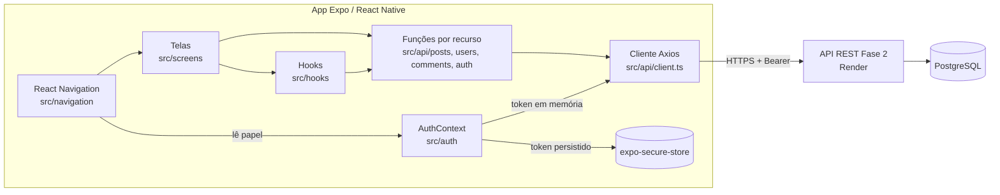

Responsabilidades principais:

- `src/screens/`: uma pasta por tela. Cuida de estado local, formulário e layout.
- `src/components/`: peças reutilizáveis com o visual da Fase 3 (`Button`, `TextField`, `PostCard`, `AsyncState`, `ConfirmDialog`, `Pagination`...).
- `src/hooks/`: lógica de tela reaproveitável (`usePosts` com busca, `useDebouncedValue`).
- `src/api/`: um arquivo por recurso com funções tipadas. As telas nunca montam URL nem header.
- `src/auth/`: `AuthContext` (sessão, papel, login/logout) e `tokenStorage` (SecureStore).
- `src/navigation/`: pilha principal e abas; é aqui que as rotas protegidas são decididas.
- `src/types/`: tipos que espelham as respostas da API.
- `src/theme/`: cores, fontes e espaçamentos copiados do CSS da Fase 3.

O documento completo, com diagramas de navegação, fluxo de login, decisões e relato de desafios, está em [docs/arquitetura.md](docs/arquitetura.md).

## 3. Telas e Navegação

A navegação usa uma pilha (native stack) com as abas dentro dela. As telas restritas só são **montadas** quando o usuário tem o papel certo; não existe atalho para abrir uma tela que não está registrada.

| Tela | Tipo | Quem acessa |
|---|---|---|
| Posts (lista + busca) | Aba | Todos, inclusive sem login |
| Post (leitura + comentários) | Pilha | Todos; comentar exige login |
| Login | Modal | Só quem não está logado |
| Administração (lista de posts com editar/excluir) | Aba | Professor |
| Novo/Editar post | Pilha | Professor |
| Pessoas (professores e alunos paginados) | Aba | Professor |
| Novo/Editar professor ou aluno | Pilha | Professor |
| Conta (dados e sair) | Aba | Qualquer usuário logado |

Sem login, a barra de abas fica escondida (só existe a aba Posts) e o cabeçalho mostra o botão **Entrar**.

## 4. Tecnologias Utilizadas

- React Native 0.88 com Expo SDK 58 (fluxo gerenciado) e TypeScript
- React 19 (componentes funcionais e hooks)
- React Navigation 7 (native stack + bottom tabs)
- Context API para o estado de autenticação
- expo-secure-store para guardar o token
- Axios para as chamadas HTTP
- Instrument Serif e Public Sans via `@expo-google-fonts` (mesmas fontes do site da Fase 3)
- Ionicons (`@expo/vector-icons`) nas abas

## 5. Integração com a API

O endereço da API vem de `EXPO_PUBLIC_API_URL` (padrão: `https://tech-challenge-vhbi.onrender.com`). Todas as chamadas passam por `src/api/client.ts`, que coloca o `Authorization: Bearer <token>` e trata a sessão expirada.

| Recurso | Rotas usadas pelo app | Autenticação | Arquivo |
|---|---|---|---|
| Auth | `POST /auth/login`, `GET /auth/me` | Não / Bearer | `src/api/auth.ts` |
| Posts | `GET /posts`, `GET /posts/search?q=`, `GET /posts/:id` | Não | `src/api/posts.ts` |
| Posts | `POST /posts`, `PUT /posts/:id`, `DELETE /posts/:id` | Bearer (professor, autor) | `src/api/posts.ts` |
| Professores | `GET/POST /teachers`, `GET/PUT/DELETE /teachers/:id` (`?page&limit`, `?deletePosts=true`) | Bearer (professor) | `src/api/users.ts` |
| Alunos | `GET/POST /students`, `GET/PUT/DELETE /students/:id` (`?page&limit`) | Bearer (professor) | `src/api/users.ts` |
| Comentários | `GET /posts/:postId/comments` | Não | `src/api/comments.ts` |
| Comentários | `POST /posts/:postId/comments`, `DELETE /posts/:postId/comments/:commentId` | Bearer (qualquer papel) | `src/api/comments.ts` |

Regras que o app respeita, mas que **quem garante é a API**:

- Aluno que tentar escrever recebe `403`. O app nem mostra as telas de escrita para aluno; isso é conveniência de interface, não segurança.
- Professor só edita e exclui os próprios posts (`403` para posts de outros). A aba Administração lista apenas os posts do professor logado.
- Excluir professor que tem posts responde `409 TEACHER_HAS_POSTS` com a quantidade de posts. O app mostra o número e só repete com `?deletePosts=true` se o usuário confirmar.
- Ninguém exclui a própria conta (`409 CANNOT_DELETE_SELF`), então o app esconde o botão Excluir na própria linha.
- Qualquer `401` em uma requisição que levou token encerra a sessão e volta para o modo visitante.

Para isso funcionar, a API da Fase 2 ganhou nesta fase papéis (`professor`/`aluno`), `GET /auth/me`, CRUD paginado de `/teachers` e `/students` e as rotas de comentários. Os detalhes estão no README daquele repositório.

## 6. Como Executar o Projeto

### Pré-requisitos

- Node.js 20+
- Celular com o app **Expo Go** (Android ou iOS) na mesma rede Wi-Fi do computador, **ou** um emulador Android / simulador iOS
- Opcional: Docker, para rodar a API da Fase 2 localmente

### 1. Escolher a API

**Opção A, API publicada (mais simples).** Não precisa fazer nada: o `.env.example` já aponta para o Render. O plano gratuito do Render "dorme" depois de um tempo parado, então a primeira requisição pode levar até ~50 s; o app espera até 60 s antes de mostrar erro.

**Opção B, API local.** Suba a Fase 2 com Docker:

```bash
git clone https://github.com/MatheusMatiasUniver/Tech-Challeng-Fase-2.git
cd Tech-Challeng-Fase-2
cp .env.example .env
docker compose up -d postgres api
curl http://localhost:3001/health
```

O celular não enxerga o `localhost` do computador. No `.env` do app, use o IP do computador na rede (por exemplo `http://192.168.0.10:3001`). No emulador Android, `http://10.0.2.2:3001` aponta para o computador.

### 2. Rodar o app

```bash
git clone https://github.com/MatheusMatiasUniver/Tech-Challeng-Fase-4.git
cd Tech-Challeng-Fase-4
npm install
cp .env.example .env   # ajuste EXPO_PUBLIC_API_URL se for usar a API local
npx expo start
```

- **Celular:** leia o QR code com a câmera (iOS) ou com o Expo Go (Android).
- **Emulador:** com o terminal do Expo aberto, tecle `a` (Android) ou `i` (iOS).
- **Navegador:** tecle `w`. Útil para olhar telas rápido, mas o navegador exige CORS: na API local, defina `CORS_ORIGINS=http://localhost:8081` no `.env` da Fase 2.

`EXPO_PUBLIC_API_URL` é lida quando o bundle é gerado. Depois de mudar o `.env`, reinicie com `npx expo start -c` para limpar o cache.

### Usuários de teste (seed da API)

Todos com a senha `123456`:

| E-mail | Papel |
|---|---|
| `professor@exemplo.com` | professor |
| `professor1@exemplo.com` | professor |
| `professor2@exemplo.com` | professor |
| `aluno1@exemplo.com` | aluno |
| `aluno2@exemplo.com` | aluno |

### Scripts

| Script | O que faz |
|---|---|
| `npm start` | `expo start`, abre o servidor de desenvolvimento e o QR code |
| `npm run android` | abre direto no emulador/aparelho Android |
| `npm run ios` | abre direto no simulador iOS (só macOS) |
| `npm run web` | abre a versão web |
| `npx tsc --noEmit` | checagem de tipos |

## 7. Guia de Uso

> As imagens abaixo foram geradas a partir da versão web do app, com dados de exemplo.

### Visitante (sem login)

Ao abrir o app, a lista de posts aparece direto, sem pedir login. Cada cartão mostra título, autor e um resumo. A busca filtra por palavras do título ou do conteúdo enquanto você digita, e puxar a lista para baixo atualiza. Tocar em um post abre a leitura completa com os comentários.

| Lista | Busca | Leitura |
|---|---|---|
| 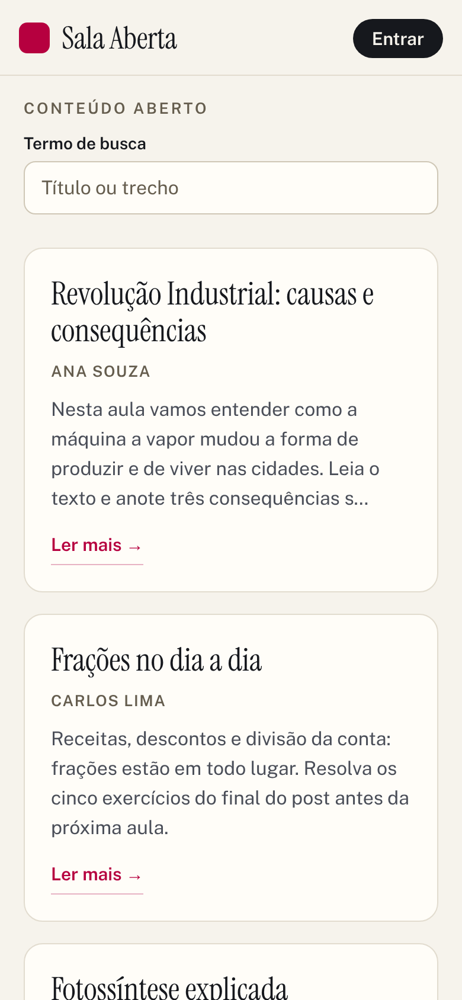 | 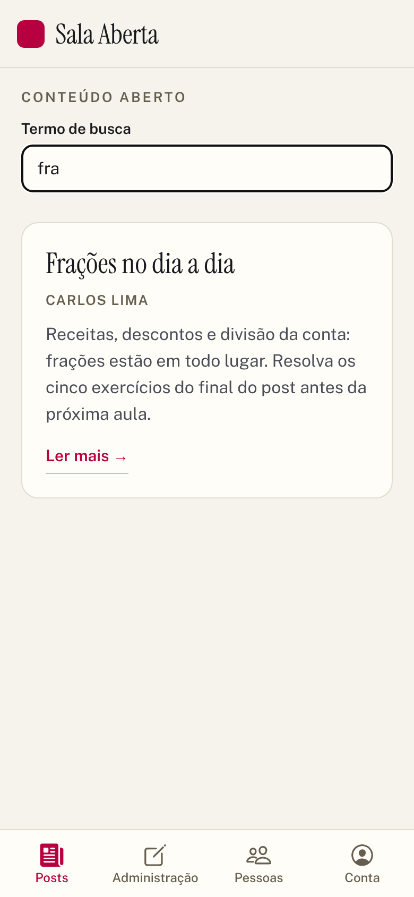 |  |

### Login

O botão **Entrar** no topo abre o login por cima da lista. Com e-mail ou senha errados, a mensagem aparece no próprio formulário. Ao entrar, a tela de login fecha sozinha e você volta para onde estava.

| Login | Erro |
|---|---|
| 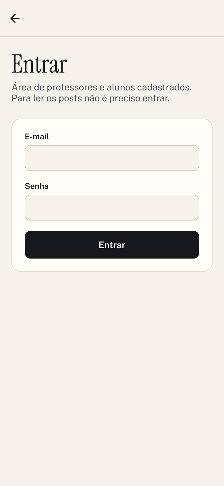 | 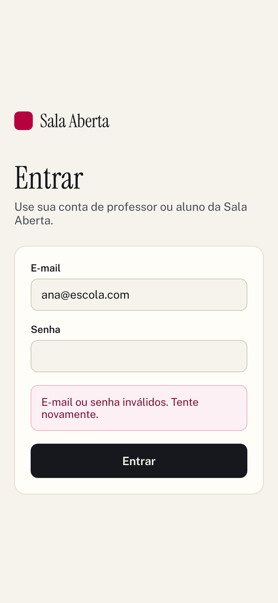 |

### Aluno

O aluno vê as mesmas listas e ganha a aba **Conta** e o campo de comentário. Ele pode excluir os próprios comentários. As abas de professor não aparecem.

| Lista do aluno | Comentar | Comentário publicado |
|---|---|---|
|  | 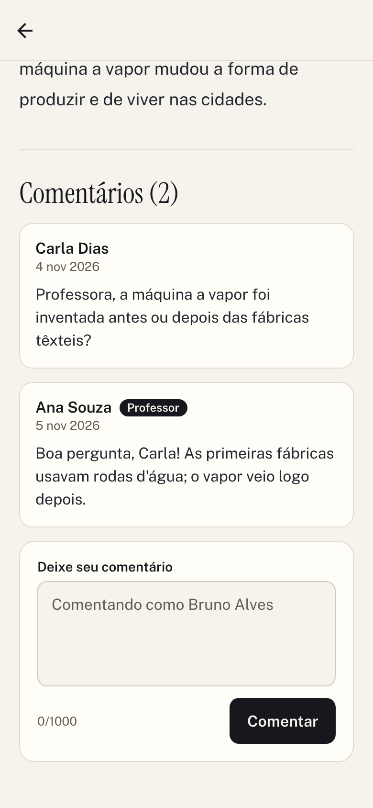 | 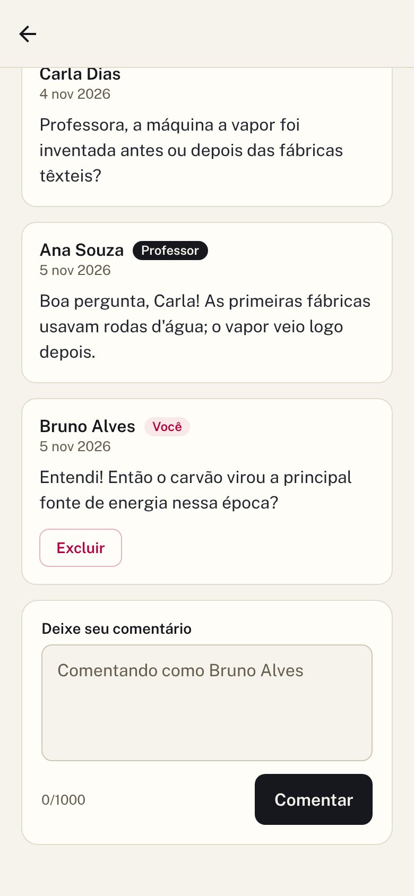 |

### Professor: posts

A aba **Administração** lista os posts do professor com **Ver**, **Editar** e **Excluir**. **Novo post** abre o formulário (título, conteúdo e autor, que é o professor logado). Editar carrega os dados atuais. Excluir pede confirmação. O professor também pode apagar qualquer comentário dos próprios posts.

| Administração | Novo post | Editar | Excluir |
|---|---|---|---|
|  | 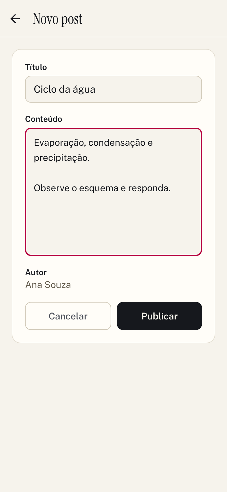 | 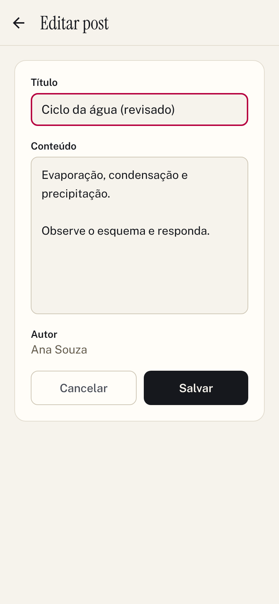 | 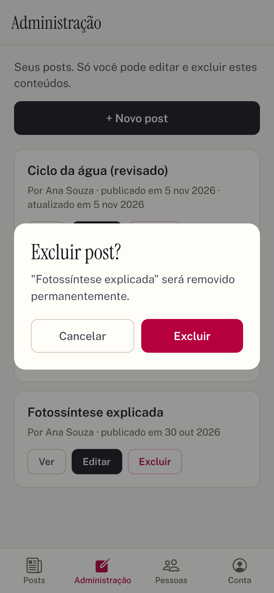 |

### Professor: professores e alunos

A aba **Pessoas** tem um seletor **Professores / Alunos**, cada lista paginada com **Anterior / Próxima**. **Novo professor** ou **Novo aluno** abre o cadastro (nome, e-mail e senha com 6+ caracteres). Na edição, a senha é opcional: em branco, continua a mesma. Ao excluir um professor que tem posts, o app avisa quantos posts serão apagados antes de confirmar.

| Professores | Professor com posts | Alunos | Cadastro | Edição |
|---|---|---|---|---|
| 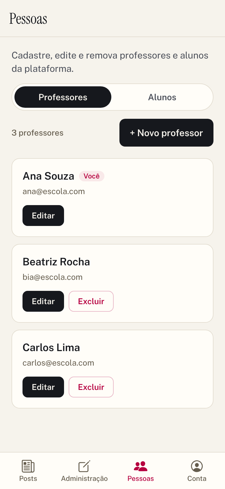 | 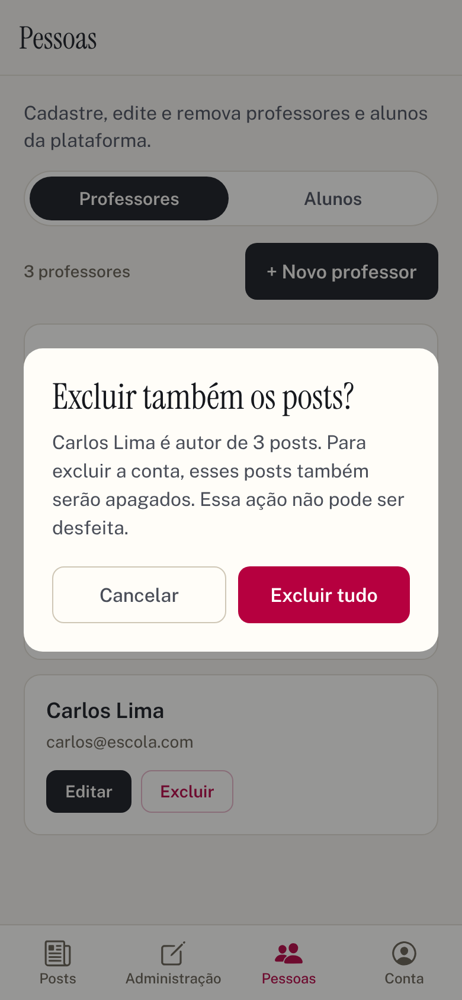 | 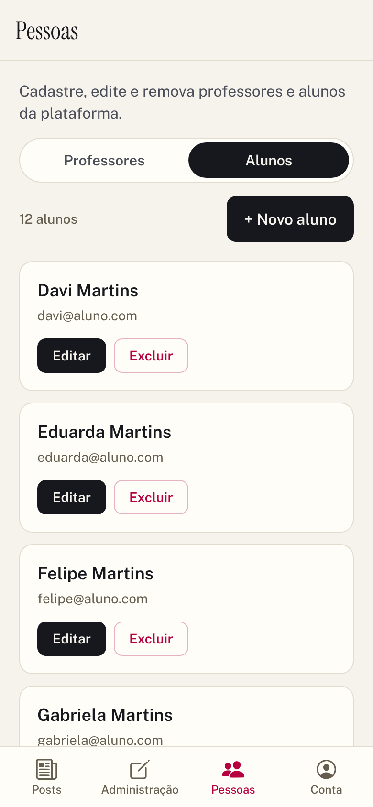 | 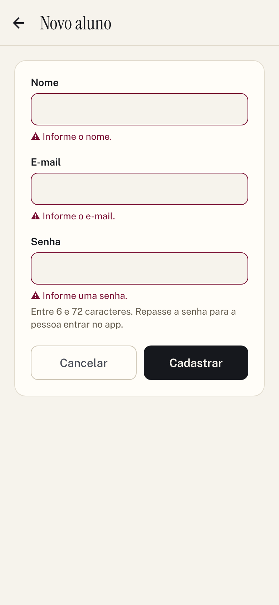 | 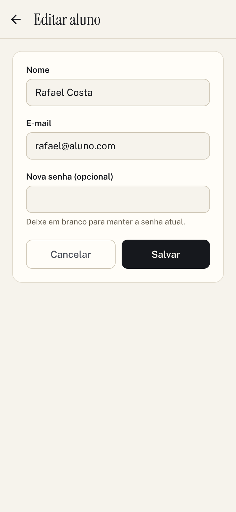 |

### Conta

A aba **Conta** mostra nome, e-mail e papel, e tem o botão **Sair**. Fechar e abrir o app mantém a sessão: o token fica salvo no armazenamento seguro do aparelho e é conferido na API ao abrir.

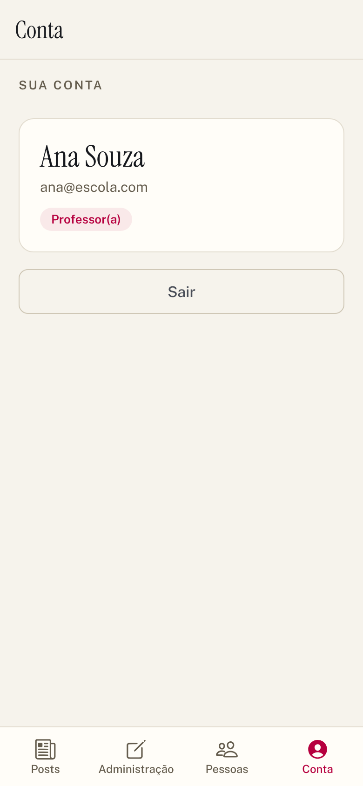

## 8. Testes e Qualidade

- **Tipos:** o projeto é todo em TypeScript em modo estrito; `npx tsc --noEmit` confere o código inteiro, inclusive o contrato com a API definido em `src/types/api.ts`.
- **Validação visual:** cada funcionalidade foi conferida na versão web do app, com a API simulada, gerando as capturas usadas no guia acima.
- **Testes automatizados:** ainda não há suíte de testes. O plano é Jest com `jest-expo` e React Native Testing Library (aula de Câmeras e Sensores 4), começando pelo `AuthContext` (login, restauração da sessão, logout no 401) e pelos formulários.

## 9. Publicação

O app roda pelo Expo Go durante o desenvolvimento. Para gerar um link público ou um APK, o caminho é o EAS (serviço de build do Expo), que compila na nuvem sem Android Studio nem Xcode:

```bash
npx eas-cli@latest login
npx eas-cli@latest build --platform android --profile preview   # gera um APK instalável
npx eas-cli@latest update --branch preview                     # publica o JS para o Expo Go
```

Essa etapa depende de uma conta Expo e ainda não foi feita.

## 10. Decisões de Design

- **Expo em vez de React Native CLI.** É o caminho das aulas, roda no celular pelo Expo Go sem montar ambiente Android/iOS, e nada do desafio precisa de código nativo próprio.
- **React Navigation em vez de Expo Router.** É a biblioteca ensinada nas aulas e deixa as rotas protegidas explícitas no código: uma tela restrita simplesmente não é registrada para quem não tem o papel.
- **Leitura sem login.** A API deixa a leitura pública e o enunciado diz que o aluno "apenas visualiza". Pedir login só para ler criaria atrito sem ganho de segurança, e o site da Fase 3 já funcionava assim.
- **Context API em vez de Redux.** O estado global é pequeno (usuário + token). O enunciado deixa a escolha opcional e Context resolve sem store, slices e actions.
- **Token no SecureStore, não no AsyncStorage.** O JWT dá acesso à conta. O SecureStore usa Keychain/Keystore, criptografados; o AsyncStorage é texto puro.
- **`/auth/me` ao abrir o app.** Confere se o token ainda vale e traz o papel atualizado do banco, então um professor rebaixado ou excluído não abre o app com as abas antigas.
- **Uma fábrica para professores e alunos.** A API usa o mesmo controller para `/teachers` e `/students`; o app espelha isso com `makeUsersApi(path)` e telas únicas que recebem o papel, evitando duas cópias quase iguais.
- **Paginação com botões.** O requisito pede lista paginada e a API devolve `totalPages`; botões deixam claro em que página se está, o que rolagem infinita esconderia.
- **Mesmo visual da Fase 3.** Cores, fontes e componentes foram copiados do site para os dois parecerem o mesmo produto. O que no site era hover virou estado pressionado e o menu do topo virou abas embaixo.

## 11. Desafios e Aprendizados

- **A API não estava pronta para o mobile.** A Fase 2 não tinha papéis, `/auth/me`, cadastro de professores e alunos nem comentários. O app só pôde avançar depois de estender a API, mantendo os contratos antigos funcionando.
- **Rotas protegidas sem "redirect".** No web a proteção era um redirecionamento; no React Navigation o padrão é registrar ou não registrar a tela. Entender isso simplificou o login: a tela de Login deixa de existir ao entrar e o app volta sozinho para onde estava.
- **Render dormindo.** A primeira chamada depois de um tempo parado leva quase um minuto. O timeout do Axios foi para 60 s e as mensagens de erro diferenciam "sem conexão" de "a API demorou".
- **Respostas fora de ordem na busca.** Digitar rápido disparava várias buscas, e uma resposta lenta podia sobrescrever a mais nova. A solução foi esperar o usuário parar de digitar (debounce) e numerar as requisições, aceitando só a última.
- **Excluir professor apagava posts.** A chave estrangeira estava em cascata. Ela passou a `RESTRICT` e o app ganhou a confirmação em duas etapas com o número de posts.
- **`localhost` no celular.** O aparelho não enxerga o servidor do computador por `localhost`; foi preciso documentar o uso do IP da rede e do `10.0.2.2` no emulador.
- **Fontes no React Native.** Cada peso de fonte é um arquivo separado, então `fontWeight` não funciona com fontes customizadas; os estilos usam uma família por peso.

Mais detalhes, com diagramas, em [docs/arquitetura.md](docs/arquitetura.md).
