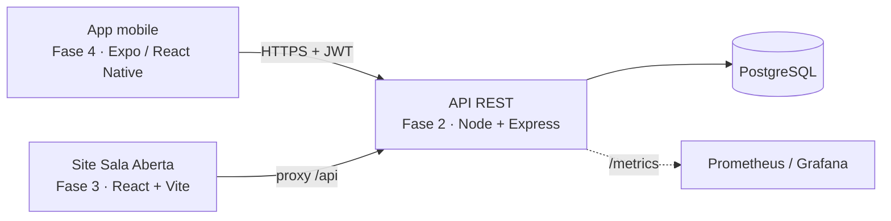
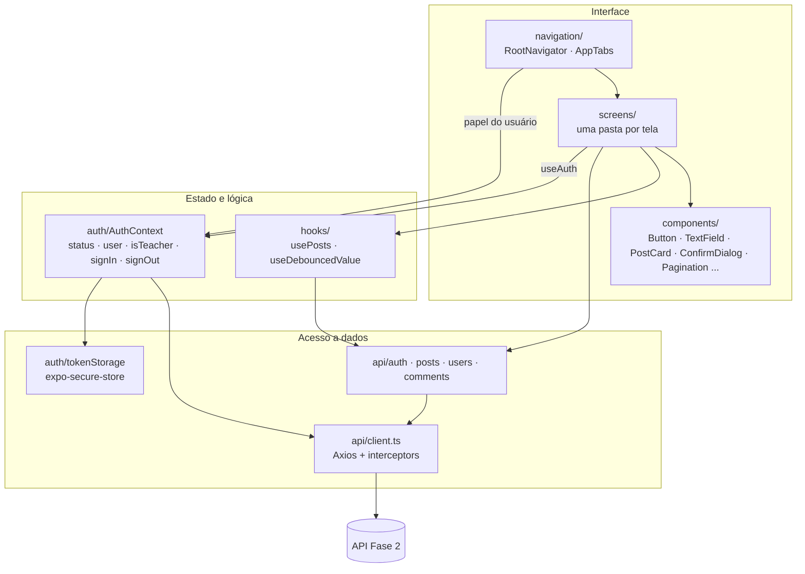
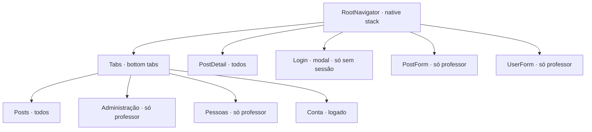
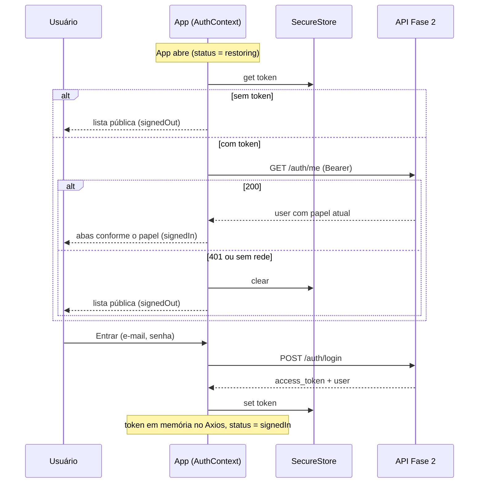
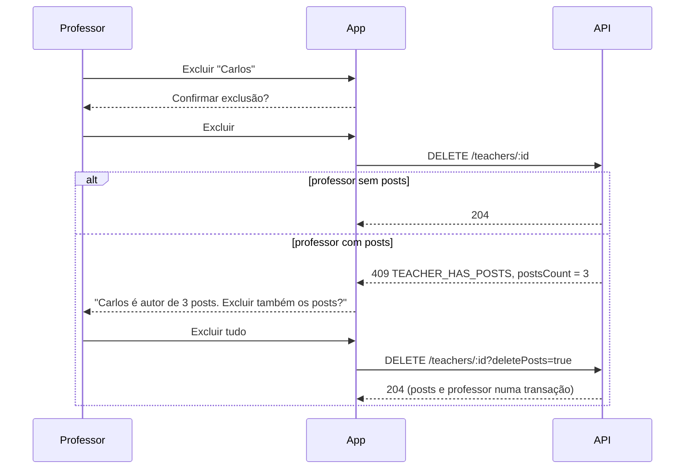

# Arquitetura do app (Fase 4)

Este é o documento de arquitetura pedido na entrega da Fase 4. Ele descreve como o app está organizado, **por que** cada decisão foi tomada, como ele conversa com a API da Fase 2 e quais desafios apareceram no caminho. O passo a passo para rodar e o guia de uso com imagens estão no [README](../README.md).

## 1. Visão geral do sistema

O blog tem três partes, uma por fase do Tech Challenge. O app mobile é um novo cliente da mesma API que o site já usava.



Diferença importante entre os dois clientes: o site precisa de um proxy de mesma origem porque o navegador aplica CORS. O app nativo faz a requisição direto, sem proxy, porque CORS é uma regra do navegador e não existe no Android/iOS.

## 2. Camadas do app



| Camada | Pasta | Responsabilidade | Não faz |
|---|---|---|---|
| Navegação | `src/navigation/` | Registra telas e decide quais existem para o papel atual | Chamar API |
| Telas | `src/screens/` | Estado local, formulários, layout, mensagens | Montar URL ou header |
| Componentes | `src/components/` | Visual reutilizável da Fase 3 | Conhecer a API |
| Hooks | `src/hooks/` | Lógica de tela compartilhável (busca, debounce) | Guardar estado global |
| Autenticação | `src/auth/` | Sessão, papel, persistência do token | Regra de negócio de posts |
| API | `src/api/` | Funções tipadas por recurso, cliente HTTP único | Mostrar UI |
| Tipos | `src/types/` | Contrato com a API (`User`, `Post`, `Comment`, `Paginated<T>`) | |
| Tema | `src/theme/` | Cores, fontes e espaçamentos | |

Estrutura de pastas:

```
App.tsx                  carrega as fontes, monta AuthProvider e RootNavigator
src/
  api/
    client.ts            Axios: baseURL, Bearer, 401 → logout, mensagens de erro
    auth.ts              login, me
    posts.ts             list, search, get, create, update, remove
    users.ts             fábrica makeUsersApi para /teachers e /students
    comments.ts          list, create, remove
  auth/
    AuthContext.tsx      estado da sessão e useAuth()
    tokenStorage.ts      get/set/clear no SecureStore
  components/            Button, SmallButton, TextField, PostCard, AsyncState,
                         ConfirmDialog, Pagination, Notice, Brand, Eyebrow, HeaderPill
  hooks/                 usePosts, useDebouncedValue
  navigation/            RootNavigator (pilha), AppTabs (abas), types, theme
  screens/               Posts, PostDetail (+ CommentsSection), Login, AdminPosts,
                         PostForm, People, UserForm, Account
  theme/                 tokens copiados de src/index.css da Fase 3
  types/api.ts           tipos das respostas da API
  utils/format.ts        datas, nome do autor, resumo do post
```

## 3. Navegação e rotas protegidas



- **A proteção é "não registrar a tela".** `RootNavigator` e `AppTabs` leem `useAuth()` e só declaram as telas de professor quando `isTeacher` é verdadeiro. Uma tela que não está registrada não pode ser aberta por nenhum caminho, nem por um `navigate()` esquecido. É o padrão recomendado pelo React Navigation para autenticação.
- **Login some sozinho.** A tela de Login só é registrada enquanto `status !== 'signedIn'`. Quando o login dá certo, ela deixa de existir e o React Navigation volta para a tela anterior, sem `navigate()` manual. Por isso o "Entrar para comentar" volta para o mesmo post.
- **Abas por papel são interface, não segurança.** Quem garante a regra é a API (`403` para aluno). O app só evita mostrar botões que dariam erro.
- **Sem login, a barra de abas fica escondida**, porque só haveria uma aba.

## 4. Autenticação

### Login e restauração da sessão



### Sessão inválida durante o uso

Um interceptor de resposta do Axios observa `401`. Se a requisição levou token, a sessão é encerrada (o token expirou ou o usuário foi excluído). Se não levou token, como na senha errada do login, o `401` é só um erro para a tela mostrar.

### Por quê

- **Context em vez de Redux:** o estado global é pequeno (usuário + token). O enunciado deixa Context ou Redux como opcional. Se o estado crescer (cache de posts compartilhado entre telas, por exemplo), o caminho é Redux Toolkit, que é a aula Medium 6.
- **SecureStore em vez de AsyncStorage:** o JWT dá acesso à conta. O SecureStore usa Keychain (iOS) e Keystore (Android), que são criptografados; o AsyncStorage é texto puro.
- **Token também em memória:** ler o SecureStore é assíncrono. Guardar uma cópia em memória no `client.ts` evita uma leitura de disco a cada requisição.
- **`/auth/me` ao abrir:** além de validar o token, traz o papel do banco. Um professor rebaixado a aluno abre o app já sem as abas de professor.

## 5. Integração com a API

- **Cliente único** em `src/api/client.ts`, com `baseURL` vinda de `EXPO_PUBLIC_API_URL`. Variáveis `EXPO_PUBLIC_*` são embutidas no bundle pelo Expo, então trocar entre API local e Render não exige mudar código.
- **Timeout de 60 s**, porque o Render gratuito "dorme" e a primeira requisição pode levar quase um minuto.
- **`getErrorMessage`** transforma qualquer falha em texto para o usuário: a mensagem da API quando existe, "A API demorou demais" no timeout, "Sem conexão com a API" sem resposta.
- **Um arquivo por recurso** com funções tipadas. As telas chamam `postsApi.list()` ou `usersApiFor(role).remove(id)` e não sabem nada de URL ou header.
- **Fábrica para professores e alunos:** `/teachers` e `/students` têm o mesmo contrato na API (um controller só). `makeUsersApi(path)` gera as duas APIs, e `PeopleScreen`/`UserFormScreen` recebem o papel por parâmetro.

| Recurso | Rotas | Quem pode |
| --- | --- | --- |
| Auth | `POST /auth/login` → `{ access_token, token_type, user }`; `GET /auth/me` | público / logado |
| Posts | `GET /posts`, `GET /posts/search?q=`, `GET /posts/:id` | público |
| Posts | `POST`, `PUT /:id`, `DELETE /:id` | professor, só nos próprios posts |
| Professores | `/teachers` CRUD, `?page&limit` → `{ data, meta }` | professor |
| Alunos | `/students` CRUD, `?page&limit` → `{ data, meta }` | professor |
| Comentários | `GET /posts/:postId/comments` | público |
| Comentários | `POST /posts/:postId/comments`, `DELETE .../:commentId` | logado; excluir só autor do comentário ou professor dono do post |

### Exclusão de professor com posts



Nada é apagado sem o usuário ver quantos posts vão junto. Na API, a chave `posts.autor_id` é `RESTRICT`, então mesmo um cliente com bug não apaga posts por acidente.

## 6. Telas e estado local

- **Lista de posts:** `usePosts(query)` decide entre `GET /posts` e `GET /posts/search`. A busca usa `useDebouncedValue` (espera o usuário parar de digitar) e numera as requisições para só a última atualizar a tela. `FlatList` com puxar para atualizar.
- **Estados de carregamento:** `AsyncState` padroniza carregando / erro com "Tentar novamente" / vazio em todas as listas.
- **Formulários:** validação no app antes de enviar (campos obrigatórios, e-mail, senha com 6+), e as mensagens da API (por exemplo e-mail repetido, `409`) aparecem no formulário. Na edição de pessoa, a senha é opcional e o `PUT` manda só os campos alterados.
- **Avisos depois de salvar:** o formulário volta para a lista passando `notice` por parâmetro de rota ("Post publicado."), mostrado no topo pelo componente `Notice`.
- **Administração:** lista os posts do professor logado (`authorId === user.id`), porque a API só permite editar e excluir os próprios. Mostrar posts de outros professores com botões que dariam `403` confundiria.
- **Paginação com botões** ("Anterior · Página X de Y · Próxima"): o requisito pede lista paginada e a API devolve `totalPages`. Cada lista (professores e alunos) lembra a própria página.

## 7. Design: mesmo visual da Fase 3

O app segue a identidade do site da Fase 3 ("Sala Aberta"), para os dois parecerem o mesmo produto.

- **Tokens:** `src/theme/index.ts` copia as variáveis CSS de `src/index.css` da Fase 3 (fundo creme `#f6f3ec`, cartões `#fffdf8`, vinho `#b6003f` como destaque, preto `#16181d` nos botões principais).
- **Fontes:** Instrument Serif nos títulos e Public Sans no texto, embutidas com `@expo-google-fonts` (funcionam sem internet depois de instaladas). No React Native cada peso é um arquivo separado, então os estilos usam `fontFamily: fonts.semibold` em vez de `fontWeight: '600'`.
- **Componentes equivalentes:** `Button`, `TextField`, `AsyncState`, `Eyebrow`, `Brand` e `PostCard` reproduzem os do site.
- **Adaptações ao toque:** o hover do site virou estado pressionado. A busca não tem botões "Buscar"/"Limpar", busca sozinha. A navegação do topo virou abas embaixo, padrão de app.

## 8. Decisões de stack

### Expo (fluxo gerenciado) com TypeScript

- **Por quê:** é o caminho das aulas de React Native Básico. Roda no celular pelo Expo Go, sem Android Studio nem Xcode, o que facilita testar e gravar o vídeo. Nada do desafio (formulários, listas, HTTP, armazenamento seguro) exige código nativo próprio.
- **TypeScript:** a API já é TypeScript; tipar as respostas deixa o contrato explícito e evita erro de nome de campo.
- **Descartado:** React Native CLI. Mais controle nativo, mas exige ambiente Android/iOS montado sem ganho para este escopo.

### React Navigation (pilha + abas)

- **Por quê:** é a biblioteca das aulas, e as rotas protegidas ficam visíveis no código (seção 3).
- **Descartado:** Expo Router (rotas por arquivos). É construído em cima do React Navigation e é bom, mas esconde a navegação atrás de convenções de pastas e foge do material das aulas.

### Leitura sem login

A API deixa a leitura pública e o enunciado diz que o aluno "apenas visualiza". Exigir login para ler criaria atrito sem ganho de segurança, e o site da Fase 3 já funcionava assim. Comentar exige login.

## 9. Testes e qualidade

- TypeScript em modo estrito (`npx tsc --noEmit`) confere o app inteiro contra os tipos da API.
- Cada funcionalidade foi validada na versão web do app com a API simulada; as capturas estão em `docs/telas/`.
- **Ainda não há testes automatizados.** Plano: Jest com `jest-expo` e React Native Testing Library (aula de Câmeras e Sensores 4), começando por `AuthContext` (login, restauração, logout no 401) e pelos formulários.

## 10. Relato de experiências e desafios

**Estender a API antes de construir o app.** O enunciado pede CRUD de professores e alunos e permissão por papel, mas a API da Fase 2 só tinha login e posts, sem papéis. Antes de qualquer tela de administração, a API ganhou a coluna `papel`, `GET /auth/me`, `/teachers` e `/students` paginados e, depois, comentários. Aprendizado: num cliente novo, a primeira tarefa é comparar o que ele precisa com o que o back-end oferece, e não começar pelas telas.

**Pensar em "telas registradas" e não em "redirecionamento".** No site, a proteção de rota era redirecionar para o login. No React Navigation o padrão é registrar a tela só para quem pode. A mudança de modelo mental simplificou o código: o Login some sozinho ao entrar e o usuário volta para onde estava.

**A API gratuita dorme.** No Render gratuito, a primeira chamada depois de um tempo parado leva quase um minuto, e o app parecia travado. O timeout do Axios foi para 60 s e as mensagens de erro passaram a distinguir "sem conexão" de "a API demorou".

**Respostas fora de ordem na busca.** Digitar rápido disparava várias buscas, e uma resposta lenta de "rea" podia chegar depois da de "react" e sobrescrever o resultado certo. A solução teve duas partes: esperar o usuário parar de digitar e numerar as requisições, aceitando só a mais recente.

**Excluir um professor apagava os posts dele sem aviso.** A chave estrangeira estava em cascata. Ela passou a `RESTRICT`, a API responde `409` com a quantidade de posts, e o app pergunta antes de apagar. É um exemplo de regra que precisa existir no banco, na API e na interface ao mesmo tempo.

**`localhost` no celular.** O aparelho não enxerga o servidor do computador por `localhost`. Foi preciso usar o IP da rede (ou `10.0.2.2` no emulador Android) e documentar isso no README.

**Fontes customizadas.** No React Native, `fontWeight` não escolhe o arquivo de uma fonte carregada; cada peso é uma família separada. Também foi preciso aumentar a barra de abas, porque a Public Sans é mais alta que a fonte do sistema e o rótulo encostava na borda.

**Trabalho em PRs empilhados.** Cada funcionalidade virou um PR pequeno em cima do anterior (base → lista → design → leitura pública → admin → pessoas → comentários). Isso facilitou revisar uma coisa por vez, com o custo de precisar mergear na ordem.
